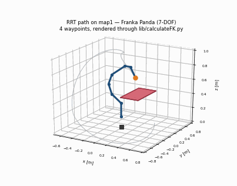

# Manipulator Control with a 7-DOF Franka Arm

## Demo



The arm follows an RRT path around the obstacle in `maps/map1.txt`. This is the real
output of `src/lib/rrt.py`, rendered offline with matplotlib through the repo's own
forward kinematics (`src/lib/calculateFK.py`). It is not Gazebo or hardware footage.
Replace `assets/demo.gif` if you record a simulator or robot run.

## Context

- Platform: 7-DOF Franka Emika Panda, driven through ROS Noetic and
  `franka_ros_interface`, in Gazebo and on the lab hardware.
- Origin: coursework for MEAM 520 at Penn. The course supplied the robot interface,
  the simulation and vision ROS package, the collision primitives, and the lab
  scaffolding. The kinematics and planning implementations are mine.
- My role: TODO — describe which labs and which parts you wrote.
- Teammates: TODO — name collaborators to credit, especially for the final
  pick-and-place project.

Files that came from the course staff rather than from me:
`src/core/` (robot interface, safety layer, vision client), `src/lib/detectCollision.py`,
`src/lib/loadmap.py`, and everything under `ros/`. Original maintainers are listed in
`ros/meam520_labs/package.xml`.

## Method

**Forward kinematics.** `src/lib/calculateFK.py` builds the Panda's pose from
Denavit-Hartenberg parameters, chaining per-joint transforms to return the eight joint
centre positions and the end-effector transform. `src/lib/calculateFKJac.py` extends this
with two virtual gripper-finger frames, giving ten frames for the planner to reason about.
`src/lib/calcJacobian.py` assembles the 6x7 geometric Jacobian from the joint axes and
positions, which `FK_velocity.py` and `calcManipulability.py` build on.

**Inverse kinematics.** `src/lib/IK_position_null.py` solves pose IK by gradient descent.
The primary task drives end-effector position and orientation error to zero using either the
Jacobian pseudo-inverse or the Jacobian transpose; a secondary joint-centering task is
projected into the null space so solutions stay away from the joint limits.
`IK_velocity.py` solves the instantaneous problem as a least-squares fit, with NaN entries
in the target twist treated as unconstrained, and `IK_velocity_null.py` adds the same
null-space projection for resolved-rate control.

**Planning.** `src/lib/rrt.py` is a bidirectional RRT in the 7-D joint space. It grows a
tree from the start and one from the goal, samples uniformly inside the joint limits,
rejects samples that collide, and connects a sample when both trees can reach it along a
100-step collision-free interpolation. Obstacle boxes are inflated by a 0.1 m safety margin.
`src/lib/potentialFieldPlanner.py` takes the gradient-descent approach: attractive forces
pull each joint toward its goal position, repulsive forces push it off nearby obstacle
boxes, the forces are mapped to joint torques, and a random walk fires when the planner
detects a collision or a local minimum.

**Vision.**  reads AprilTag detections, shifts each tag to its cube's centre, rotates the six faces into a common frame, averages the
tags seen on the same cube, and publishes `BlockDetectionArray`. Tag IDs above 47 mark
cubes on the spinning turntable, so static and moving blocks are distinguished by ID.
`ObjectDetector` in `src/core/interfaces.py` is the client side: it returns block poses in
the camera frame and the camera-to-end-effector transform, backed by Gazebo ground truth
in simulation and by the AprilTag pipeline on hardware.

## Results

Measured by running this repo's code directly in Python 3.10 (numpy 2.2, scipy 1.15) on
one laptop. No robot or simulator is involved, so these are algorithm numbers, not
hardware numbers.

| Measurement | Result |
|---|---|
| RRT on `map1`, 10 seeds | 10/10 solved, median 0.30 s (0.05–0.72 s), median 3 waypoints |
| IK, 10 targets, pseudo-inverse | 10/10 solved, median 69 iterations, median 24.5 ms |
| IK, 10 targets, Jacobian transpose | 2/10 solved, median 998 iterations (1000 cap), median 336 ms |
| Potential field on `map1` | does not converge: hits the 500-step cap, ends 2.97 rad from the goal |

The IK targets are the ten poses in `scripts/ik_visualize.py`, all from the same neutral
seed with `alpha=0.5`. The pseudo-inverse and transpose rows use identical targets and
seeds, so the gap between them is a property of the two update rules.

Two honest limitations:

- The potential field planner does not reach the goal on `map1` with its default
  parameters. It is implemented and it runs, but it is not tuned.
- `scripts/pick_place.py` is still the course template. It connects to the arm, reads
  block detections, and prints them. The grasp and stacking logic was never committed to
  this repo, so there are no pick-and-place results to report.

TODO: add Gazebo or hardware numbers (cycle time, blocks stacked, success rate) if you
have them from the final project.

## How to run

Install the Python dependencies:

```bash
pip install -r requirements.txt
```

Only `scripts/fk_workspace.py` runs from a plain Python install. Everything else needs
ROS Noetic, `franka_ros_interface`, and the `meam520_labs` package in `ros/` built in a
catkin workspace, with the matching `roslaunch` already running. Those scripts are listed
below for completeness; they will fail on import without ROS.

Plot the reachable workspace (no ROS needed):

```bash
python scripts/fk_workspace.py
```

Run a library module on its own (no ROS needed):

```bash
PYTHONPATH=src python src/lib/rrt.py
```

```bash
PYTHONPATH=src python src/lib/IK_position_null.py
```

Needs ROS and a running simulator or robot:

```bash
python scripts/lab0_demo.py
```

```bash
python scripts/fk_visualize.py FK
```

```bash
python scripts/ik_visualize.py
```

```bash
python scripts/ik_velocity_visualize.py
```

```bash
python scripts/ik_follow.py line
```

```bash
python scripts/ik_velocity_follow.py ellipse
```

```bash
python scripts/rrt_demo.py 1
```

```bash
python scripts/potential_field_demo.py 1
```

```bash
python scripts/pick_place.py
```

`ik_follow.py` and `ik_velocity_follow.py` take `line`, `ellipse`, or `eight`. The two
planner demos take a map index from 1 to 5, matching `maps/`. Scripts put `src/` on
`sys.path` themselves via `scripts/_bootstrap.py`, so they can be run from any directory.

## Repo structure

```
.
├── assets/                 # README images and GIFs
│   └── demo.gif
├── maps/                   # obstacle maps for the planners
├── requirements.txt
├── ros/
│   └── meam520_labs/       # catkin package: launch, worlds, URDF, msgs, vision nodes
│       ├── config/         # camera calibration, AprilTag settings, RViz configs
│       ├── launch/
│       ├── msg/            # BlockDetection, BlockDetectionArray, TransformStampedList
│       ├── scripts/        # block_spawner.py, getBlockPose.py, worldConverter.py
│       ├── urdf/
│       └── worlds/
├── scripts/                # runnable entry points
│   ├── _bootstrap.py       # puts src/ on sys.path
│   ├── fk_visualize.py
│   ├── fk_workspace.py
│   ├── ik_visualize.py
│   ├── ik_follow.py
│   ├── ik_velocity_visualize.py
│   ├── ik_velocity_follow.py
│   ├── rrt_demo.py
│   ├── potential_field_demo.py
│   ├── lab0_demo.py
│   └── pick_place.py
└── src/
    ├── core/               # course-provided arm interface, safety layer, vision client
    │   ├── interfaces.py   # ArmController, ObjectDetector
    │   ├── safety.py
    │   └── utils.py
    └── lib/                # kinematics and planning
        ├── calculateFK.py
        ├── calculateFKJac.py
        ├── calcJacobian.py
        ├── calcAngDiff.py
        ├── calcManipulability.py
        ├── FK_velocity.py
        ├── IK_velocity.py
        ├── IK_velocity_null.py
        ├── IK_position_null.py
        ├── rrt.py
        ├── potentialFieldPlanner.py
        ├── detectCollision.py
        ├── loadmap.py
        └── lab0Utils.py
```

## Acknowledgments

- MEAM 520 course staff at the University of Pennsylvania for the robot interface,
  simulation environment, vision pipeline, and lab scaffolding: Jake Welde,
  Shane Rozen-Levy, Victoria Edwards, and Xu Liu.
- `src/core/interfaces.py` is adapted from the `panda_robot` package by Saif Sidhik
  and from Rethink Robotics code, used under the Apache License 2.0. The original
  copyright and license notice is kept at the top of that file.
- The point-to-box distance routine in `src/lib/potentialFieldPlanner.py` follows a
  method posted by MultiRRomero on Stack Overflow, credited in the docstring.
- TODO: add teammates from the final project.
